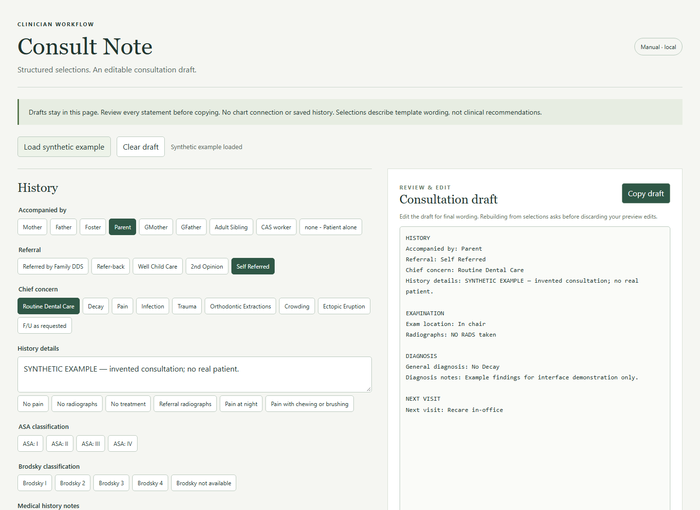

# Consult Note

A focused, manual consultation note builder extracted from a working pediatric dental documentation tool. It organizes reusable history, examination, diagnosis, treatment discussion, and next-visit phrases into an editable draft.



## Why it exists

I write approximately **40–50 patient notes a day**. Open Dental's automatic and quick notes did not provide enough flexibility for my volume and workflow. I built this tool to select familiar clinical phrases quickly while keeping the resulting narrative available for review and editing.

## Run locally

Requires Node.js 22 or newer and a modern browser. There are no npm dependencies and no credentials to configure.

```sh
npm start
```

Open [http://127.0.0.1:4173](http://127.0.0.1:4173). The server listens only on the local loopback interface. Open the served URL rather than double-clicking the HTML file.

```sh
npm test
```

## Try the workflow

1. Load the explicitly labeled synthetic example, or begin with the blank draft.
2. Choose confirmed findings and applicable template statements. Single-choice items can be clicked again to deselect. Multi-choice fields permit several selections.
3. Add encounter details in the notes areas. History detail buttons toggle common phrases, and selected treatment options have their own optional detail fields. Review wording concerning counseling, treatment, consent, and next steps carefully.
4. Edit the draft directly for final wording, then copy it. Changing a structured field asks for confirmation before replacing direct preview edits.
5. Clear the draft before another example. Clear and example replacement ask for confirmation when a draft exists. Reloading also clears the in-memory state.

If clipboard access fails, the app selects the draft so you can press Ctrl/Cmd+C. The operating system and other applications may retain clipboard content.

## Scope and privacy

This standalone edition supports consult phrases and manual drafting. The example is entirely synthetic. It has no Open Dental connection, patient lookup, AI endpoint, API key, chart posting, persistent draft storage, or saved history. It does not load the production workspace or source git history.

The original template's local anesthesia-provider names and unused preoperative fields were excluded. Original unconditional normal-exam and guardian-understanding boilerplate were not carried over: this edition starts blank and emits only selected or entered content. Detailed clinical phrase wording remains a template for review, including some jurisdiction-specific terminology; it is not clinical guidance.

Every draft needs review by the responsible clinician. No validation of diagnostic correctness, consent sufficiency, regulatory compliance, time savings, or production readiness is claimed. The app is not a medical record system. Use an appropriately managed local workstation, protect access to drafts and clipboard content, and transfer the final reviewed note into your authorized clinical record workflow.

See [architecture](ARCHITECTURE.md), [privacy](PRIVACY.md), [security](SECURITY.md), and [testing](TESTING.md).

## Repository contents

`index.html`, `styles.css`, and `app.js` implement the UI and pure note-building functions. `template-options.json` contains allowlisted consultation phrases. `server.cjs` serves only the five public UI resources. `test/` contains executable Node tests. No build step, external fonts, analytics, or image services are used.

## License

MIT — see [LICENSE](LICENSE).
